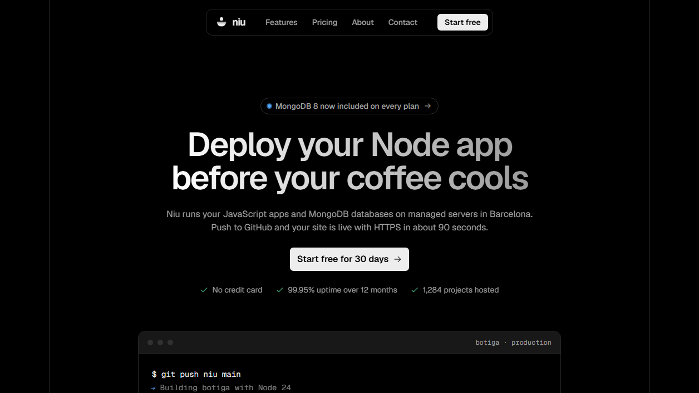
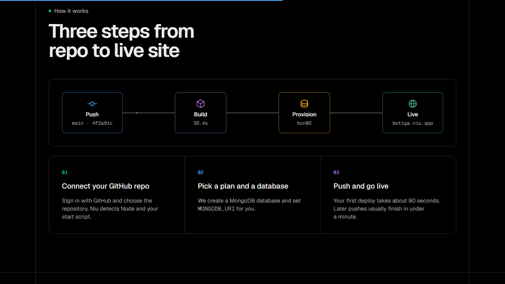
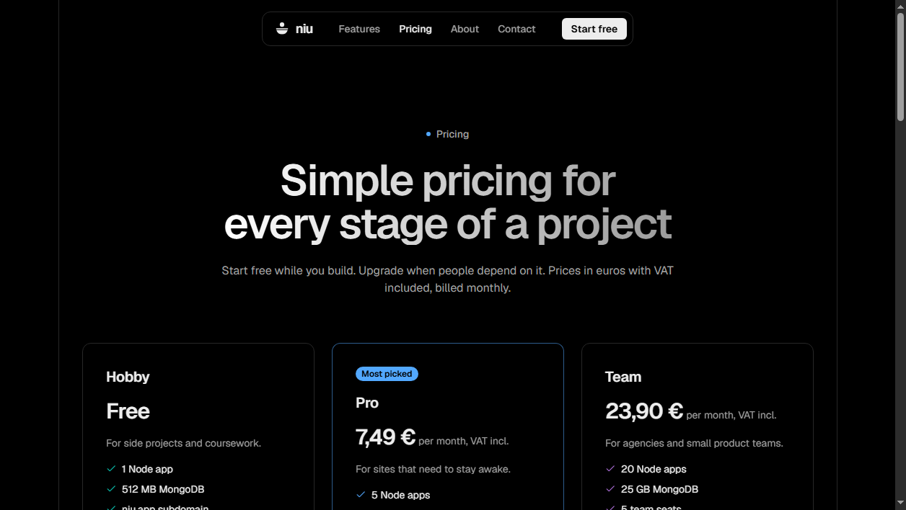
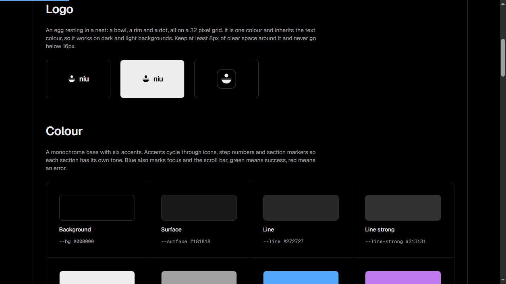
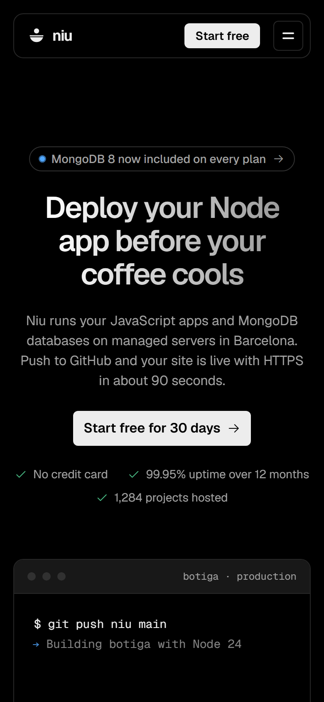
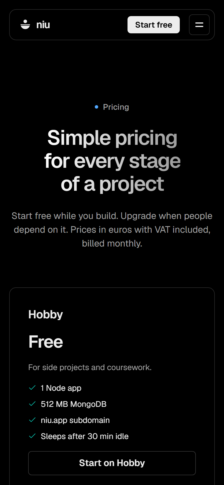

# Niu

Landing page and API for **Niu**, a fictional managed hosting company for Node.js and MongoDB apps.
The project idea, business model and links are in [docs/PROJECT.md](docs/PROJECT.md).



## Screenshots

| Deploy pipeline (GSAP) | Pricing (plans loaded from MongoDB) |
|---|---|
|  |  |

| Style guide | Mobile (390px) |
|---|---|
|  |   |

Screenshots live in `docs/images`.

## Stack

| Part | Tech |
|---|---|
| Monorepo | pnpm workspaces + Turborepo |
| Frontend (`apps/web`) | Vanilla JavaScript, plain CSS, Vite, GSAP (ScrollTrigger, SplitText, TextPlugin, ScrambleTextPlugin), Phosphor icons, Geist font |
| Backend (`apps/api`) | Node.js 24, Express 5, Mongoose 9 |
| Database | MongoDB 8 |
| Runtime | Docker Compose (mongo + api + web behind nginx) |

```
.
├── apps/
│   ├── api/            Express API: /api/health, /api/plans, /api/signups, /api/messages
│   │   ├── src/        app.js, models.js (schemas + seed), validate.js, index.js
│   │   └── test/       node:test unit tests
│   └── web/            Static multi page site built with Vite
│       ├── *.html           index, features, pricing, about, contact, styleguide, legal, 404
│       ├── partials/        head, nav, cta, footer (inlined at build by a small Vite plugin)
│       ├── nginx.conf       serves dist/ and proxies /api to the api service
│       └── src/             main.js (nav, forms, plans), animations.js (GSAP), styles.css
├── docs/
│   ├── PROJECT.md      project document
│   └── images/         README screenshots
├── Dockerfile          multi stage: api, web
├── docker-compose.yml
├── turbo.json
└── pnpm-workspace.yaml
```

## Run everything with Docker (recommended)

Requirements: Docker Desktop.

```bash
docker compose up -d --build
```

Open http://localhost:8080. The API seeds the three plans into MongoDB on its first start.

```bash
docker compose logs -f api   # follow API logs
docker compose down          # stop
docker compose down -v       # stop and delete the database volume
```

## Local development

Requirements: Node 24+, pnpm 12, Docker (only for MongoDB).

```bash
pnpm install
pnpm db     # starts only the MongoDB container, on 127.0.0.1:27017
pnpm dev    # Turborepo runs web (Vite, http://localhost:5173) and api (:4000) together
```

To use another MongoDB instance, `cp apps/api/.env.example apps/api/.env` and edit `MONGODB_URI`.
Vite proxies `/api` to `http://localhost:4000` (override with `API_URL`).

### Scripts (root)

| Command | What it does |
|---|---|
| `pnpm dev` | Runs every app in watch mode through Turborepo |
| `pnpm build` | Builds the web app into `apps/web/dist` |
| `pnpm test` | Runs the API unit tests |

## API

| Method | Path | Body | Responses |
|---|---|---|---|
| GET | `/api/health` | | `200 {ok:true}` |
| GET | `/api/plans` | | `200 [{slug,name,priceCents,blurb,features,order}]` |
| POST | `/api/signups` | `{email, plan}` | `201`, `400` invalid input, `409` email already registered |
| POST | `/api/messages` | `{name, email, topic, message}` (topic: `sales`, `support`, `education`) | `201`, `400` invalid input |

Collections: `plans` (seeded on startup when empty), `signups` (unique email) and `messages` (contact form).

## Adding a page

Create `apps/web/<name>.html` with `<!-- include:head -->`, `<!-- include:nav -->` and `<!-- include:footer -->`. Vite picks up every root `.html` file automatically, and nginx serves it at `/<name>`.

## Environment variables (api)

| Name | Default |
|---|---|
| `MONGODB_URI` | `mongodb://127.0.0.1:27017/niu` |
| `PORT` | `4000` |

## Notes

Prices, uptime figures, customer counts and testimonials on the landing page are fictional demo content.
